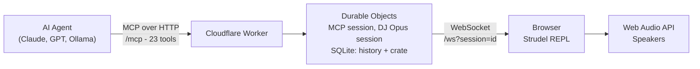

# DJ Opus

[](LICENSE)
[](cloudflare/tsconfig.json)
[](https://workers.cloudflare.com)
[](cloudflare/mcp/)
[](https://strudel.cc)

AI-powered live-coding music platform built on Cloudflare Workers. Connect any AI agent to a browser-based synthesizer over MCP and make music in real time. This is a work in progress that works today - make it your own, or take a spin with DJ Opus.

DJ Opus bridges AI models and the [Strudel](https://strudel.cc) live-coding environment through the [Model Context Protocol](https://modelcontextprotocol.io/) (MCP), enabling AI-assisted composition, mixing, and live performance of electronic music - or whatever else you're into.

## Sixty Seconds to Music

The hosted instance is **https://play.djopus.party**. Its MCP endpoint is `https://play.djopus.party/mcp`, and that URL is all your agent needs: the tools, the DJ know-how, the genre references and a library of patterns all come over it.

1. **Add the server** to your MCP client. In Claude Code (a terminal, not inside a Claude session):

   ```bash
   claude mcp add --transport http djopus https://play.djopus.party/mcp
   ```

   Any client with a JSON config takes the same thing (for Claude Code that file is `.mcp.json`; `type` is required, an entry with a `url` but no `type` is read as a stdio server):

   ```json
   { "mcpServers": { "djopus": { "type": "http", "url": "https://play.djopus.party/mcp" } } }
   ```

2. **Ask for music.** "Play me some dream trance." The agent's first tool call answers with your player URL, `https://play.djopus.party/s/<id>`. Open it and click once to unlock audio.

3. **Ask again.** You are paired: the agent writes Strudel code, your browser plays it, and the sliders in the pattern are yours to move.

Check the connection with `claude mcp list`, or `/mcp` inside a Claude Code session. For a client without HTTP MCP support, see [Compatibility](#compatibility). To run your own copy, see [Self-Hosting](#self-hosting).

## What Your Agent Gets Over MCP

Nothing to install beyond the URL. The server tells the agent how to DJ:

| What | How it arrives | Contents |
|---|---|---|
| 23 tools | `tools/list` | write, play, stop, set_tempo, replace_code, undo, save, load, compose, connect, ... ([tool reference](cloudflare/README.md#mcp-tools-23)) |
| The rules | server `instructions` on connect | The player flow, the one-pattern-with-sliders architecture (no hard cuts), live-edit etiquette, what the server refuses, saving |
| Two modes | MCP prompts `megamix` and `tag-team` | A planned extended set you drive with sliders; rapid back-and-forth jamming |
| The references | MCP resources `djopus://reference/<name>` | `strudel-cheatsheet`, `genres`, `classic-tracks`, `sample-banks` |
| 16 patterns | the `list` and `load` tools | The curated [`patterns/`](patterns/) library, next to your session's own saved crate |

The same material is the Claude Code skill in [`skills/dj-opus/`](skills/dj-opus/), for people who want it to trigger on its own in Claude Code: see [DJ Opus Skill](#dj-opus-skill). The resources and the skill's references are the same files, built into the Worker, so they cannot drift apart.

## Claude Code Plugin

The repo is also a Claude Code plugin marketplace. Installing the plugin gives you the MCP server entry above and the [`dj-opus` skill](skills/dj-opus/) together, with no clone:

```bash
claude plugin marketplace add jmoore2333/djopus
claude plugin install djopus@djopus
```

The skill then triggers on music talk by itself, and is `/djopus:dj-opus` by name. If you already added the server with `claude mcp add`, remove that entry first (`claude mcp remove djopus`), or the tools show up twice.

## ChatGPT App

DJ Opus for ChatGPT is being prepared for submission to OpenAI for review and approval; it is not yet publicly listed. Its inline Strudel player, Worker, and plugin source are available in the [`chatgpt/`](chatgpt/) directory as a reference.

## Architecture



## What's Here

```
djopus/
├── cloudflare/           # The application (Worker + MCP endpoint)
│   ├── src/              # Cloudflare Worker: /mcp, WebSocket relay, session Durable Objects, pattern generation
│   ├── mcp/              # Thin stdio-to-HTTP proxy, for MCP clients that cannot take a URL
│   ├── client/           # Browser WebSocket bridge script
│   └── patches/strudel/  # Patches applied to the pinned Strudel build (AGPL-3.0-or-later)
├── patterns/             # 16 curated example patterns from DJ sessions
└── skills/
    └── dj-opus/          # Claude Code skill for live DJ workflows, with the references it uses
```

## How It Works

The AI sends commands (`compose`, `write`, `set_tempo`, `undo`) to the Worker's `/mcp` endpoint. Each MCP session gets its own Durable Object, which drives a DJ Opus session: another Durable Object that holds the current pattern, the undo/redo history and the session's crate of saved patterns (in its SQLite storage), and relays commands over a WebSocket to the player in your browser, where Strudel synthesizes the audio. When you play code by hand (Ctrl+Enter), the player reports it to the session, so the agent works from what is really playing.

See [`cloudflare/README.md`](cloudflare/README.md) for full architecture details, the deployment guide and the tool reference.

## Self-Hosting

You need Node.js 22+, a Cloudflare account (the free tier works) with a zone (a domain on Cloudflare) for the app's custom domain, and `git` and `rsync` for the Strudel build. The app uses no D1 database, and no secrets are required.

```bash
# 1. Clone and install
git clone https://github.com/jmoore2333/djopus.git
cd djopus/cloudflare
npm ci

# 2. Build the Strudel REPL into static/
#    Clones Strudel at a pinned commit, applies patches/strudel/, builds it, adds the bridge script
npm run build:strudel

# 3. Set your domain: change the [[routes]] pattern in wrangler.toml to a hostname
#    on a zone in your Cloudflare account. The deploy creates its DNS record and certificate;
#    the hostname must not already have a CNAME record
npx wrangler login

# 4. Deploy (it checks first that static/ is a finished build)
npm run deploy

# 5. Register it
claude mcp add --transport http djopus https://your-domain.com/mcp
```

The two `[[ratelimits]]` blocks in `wrangler.toml` use a `namespace_id` that must be unique in your account: change them if another Worker there uses the same numbers.

The logs carry a keyed hash of the session id, never the id. Set the key with `npx wrangler secret put LOG_HASH_KEY` if you want the same session to hash the same way across isolates; unset, each isolate picks a random key.

If you change the player (the patches, the Strudel commit or the bridge script) and deploy it, point its "Source" link (`SOURCE_LINKS` in `cloudflare/client/strudel-ws-bridge.js`) at your own copy of the source. See [NOTICE](NOTICE).

[`cloudflare/README.md`](cloudflare/README.md#quick-start) has the same steps in more detail.

## Example Patterns

The [`patterns/`](patterns/) directory contains 16 patterns from live DJ sessions. They are also the read-only library every session can `list` and `load`:

| Pattern | Style | BPM | Description |
|---------|-------|-----|-------------|
| `4am-donato-dozzy` | Minimal/Hypnotic | 124 | Deep underwater techno with perlin filter drift |
| `megamix-v2-robert-miles` | Trance | 138 | Dreamy piano lead with 8-slider mega-mix |
| `galactic-euphoria-drop` | Epic Trance | 138 | Full euphoric drop with GM pads and reverb |
| `acid-303-bass` | Acid | 138 | Classic squelchy 303 with filter automation |
| `closing-set` | Ambient | 118 | No-kick wind-down with vowel filter pads |
| `progressive-groove` | Progressive House | 132 | Sasha/Digweed hypnotic groove |

## DJ Opus Skill

The [`skills/dj-opus/`](skills/dj-opus/) directory contains a Claude Code skill for live DJ performances. Two modes:

- **Megamix** — autonomous extended DJ sets with full arc design (intro, build, peak, wind-down)
- **Tag Team** — collaborative live coding where you and the AI build up, remix, and shape sound together

The skill encodes genre knowledge, pattern code best practices, and production techniques learned from live sessions. Install it with the [plugin](#claude-code-plugin), or copy the folder into `.claude/skills/` of a project. Agents on other clients get the same material over MCP (see [What Your Agent Gets Over MCP](#what-your-agent-gets-over-mcp)).

## Session Pairing

Each DJ Opus session has an unguessable id of 26 characters, and the player for it is `https://play.djopus.party/s/<id>`. The id is the only thing that lets a browser into a session, so treat the player URL like a private link. Many people can share one deployment without seeing each other.

**Agent first (the usual way):**
1. Your agent's first tool call that needs a player starts a session and fails with a message that names the player URL (`get_state` returns it as `playerUrl`). Open that URL, then the agent runs the tool again.
2. Click once on the page to unlock audio. The status pill reads "Waiting for your agent" until the agent's first command reaches the page, and then shows the connection state. It also links to the source of DJ Opus and of the Strudel build, which is AGPL-3.0.

**Player first:**
Open `https://play.djopus.party`. It starts a new session and moves to `/s/<id>`. Tell the agent *"connect to <id>"* (the 26 characters after `/s/`) and it calls the `connect` tool to bind to that player. `connect` also takes an agent back to its player after a restart.

**Sharing a session:**
Every tab that has the same `/s/<id>` URL open receives the agent's commands, so each one plays what the agent plays. A manual edit in one tab is not relayed to the other tabs. A tab that joins later shows the session's current code and starts playing with the agent's next command.

**Playing by hand:**
Code you run yourself (Ctrl+Enter or the play button) is reported to the session, so the agent's `get_code`, `undo` and `redo` start from what is really playing.

## Saving Patterns

Each session has a private **crate**: `save` puts the current pattern in it, `load` and `list` read from it, and `delete` removes from it. A crate holds up to 50 patterns. A session, its crate included, is deleted after 30 days without activity.

Next to the crate is the **library**: the curated [`patterns/`](patterns/), read-only, which `load` and `list` also see.

To keep a pattern for good, have the agent write its code to a file in your project.

## Compatibility

`/mcp` is a standard remote MCP server (Streamable HTTP), so it works with:

- **Claude Code** and any other client that can take an MCP URL
- **Any MCP-compatible client** — [mcphost](https://github.com/nicholasgasior/mcphost), [mcp-cli](https://github.com/wong2/mcp-cli), custom integrations
- **Local models** — Ollama, LM Studio, llama.cpp with an MCP harness

**Clients without HTTP MCP support** can use the stdio proxy in [`cloudflare/mcp/`](cloudflare/mcp/). It is a thin stdio-to-HTTP adapter for the same `/mcp` endpoint (`DJOPUS_URL` sets the host and defaults to `https://play.djopus.party`):

```bash
cd cloudflare/mcp && npm install
claude mcp add --transport stdio \
  -e DJOPUS_URL=https://your-domain.com \
  -s user \
  djopus -- "$PWD/node_modules/.bin/tsx" "$PWD/src/index.ts"
```

## Runs Free on Cloudflare

The entire stack runs on Cloudflare's free tier: Workers, Durable Objects (SQLite-backed) and static assets. No servers, no containers, no database to run, no billing surprises. See [`cloudflare/README.md`](cloudflare/README.md) for the full free-tier breakdown.

## Credits

- **[Strudel](https://strudel.cc)** by Alex McLean and contributors — the live-coding pattern language (AGPL-3.0). DJ Opus serves a patched build of the Strudel REPL. The build is pinned to a Strudel commit and the patches are in `cloudflare/patches/strudel/`; `npm run build:strudel` fetches Strudel's source from its own repository and does not include it here.
- **[strudel-mcp-server](https://github.com/williamzujkowski/strudel-mcp-server)** by William Zujkowski — the original Playwright-based MCP server (MIT). Music theory services were ported from this project.
- **[Cloudflare Workers](https://workers.cloudflare.com/)** — edge deployment platform
- **[Model Context Protocol](https://modelcontextprotocol.io/)** by Anthropic — the agent-tool communication standard
- **[TidalCycles](https://tidalcycles.org/)** — the Haskell live-coding language that Strudel is based on

## License

DJ Opus is [MIT](LICENSE), except the Strudel patches in [`cloudflare/patches/`](cloudflare/patches/), which are [AGPL-3.0-or-later](cloudflare/patches/LICENSE) like Strudel itself. [NOTICE](NOTICE) explains the split and lists third-party code.

The Strudel REPL (not included in this repo) is AGPL-3.0-or-later. `npm run build:strudel` fetches it at a pinned commit, applies the patches and builds it, as described under Self-Hosting; that commit, the patches and the build script are the source of the player. The player links to the source of DJ Opus and to the Strudel commit it is built from.

---

Built by [moore.nyc](https://moore.nyc)
